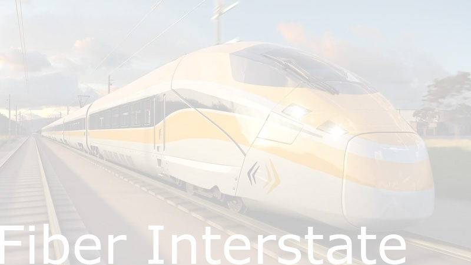
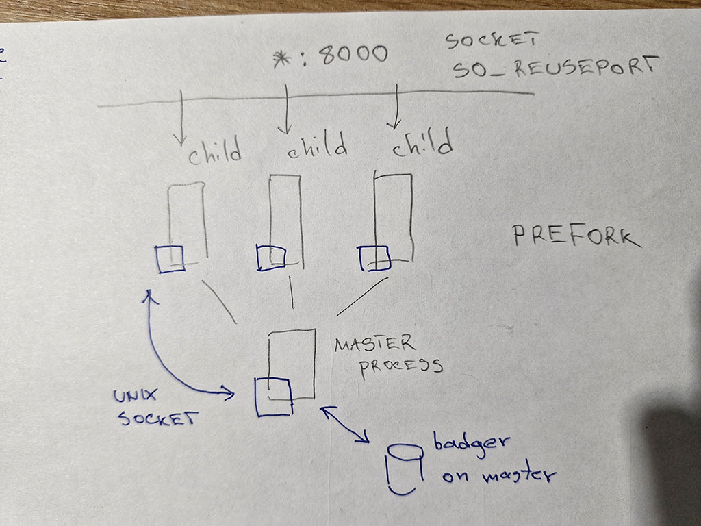

# fiberinterstate
Golang Fiber can be Speedest Train

<p align="center">
    
</p>

## Badger with prefork

You can use badger storage and prefork together.

Master and prefork children can talk.

## How It Works Under the Hood

When you start a preforked Fiber app:

- The **master process** starts and detects it is the parent.
- It forks `runtime.GOMAXPROCS(0)` child processes (typically one per CPU core).
- Each **child process** creates its own `fasthttp` server and binds to the same port.
- The kernel's `SO_REUSEPORT` distributes incoming connections across children.
- The master monitors children and restarts them if they crash.

Each child is an independent OS process with its own Go runtime, its own goroutine scheduler, and its own memory. There is no shared state between children.

## When It Actually Helps

Prefork mode helps in a very specific scenario: **CPU-bound workloads that saturate the Go scheduler**.

Go's runtime scheduler is good, but it has overhead. When every request requires heavy computation - image processing, cryptographic operations, complex template rendering - the scheduler's lock contention becomes measurable. Prefork eliminates cross-process scheduler contention because each process has its own scheduler.

Benchmarks show measurable improvement (10-20% more throughput) for:

- Heavy JSON serialization/deserialization
- Template rendering with complex logic
- Image processing or PDF generation
- Cryptographic operations per request


## Scheme

<p align="center">
    
</p>

## Code

Middleware connect

```golang

// Fiber v3 init
app := fiber.New()

app.Use(fiberinterstate.New(fiberinterstate.Config{

    App: app,
    BadgerDirectory: path.Join(conf.ConfigRoot, "db", "registry.bd."+conf.Version),
    LogEnable: true,
}))

app.Listen(":3000", fiber.ListenConfig{
    EnablePrefork: true,
})

```

## Inside the controller

```golang

import (
    fis "github.com/western/fiberinterstate"
)

res, err := fis.Get(key string) (string, error)
err := fis.Set(key, value string) (error)
err := fis.Delete(key string) (error)

```


